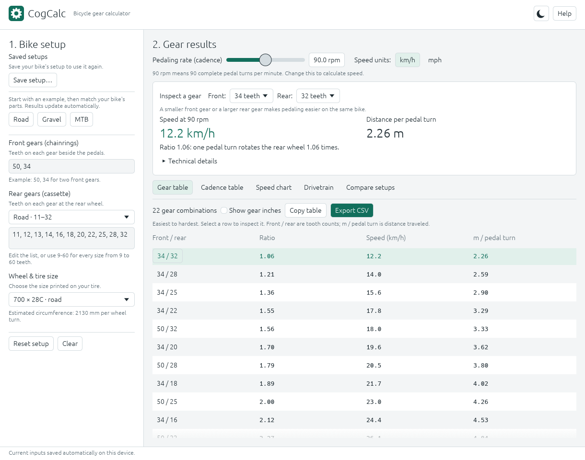
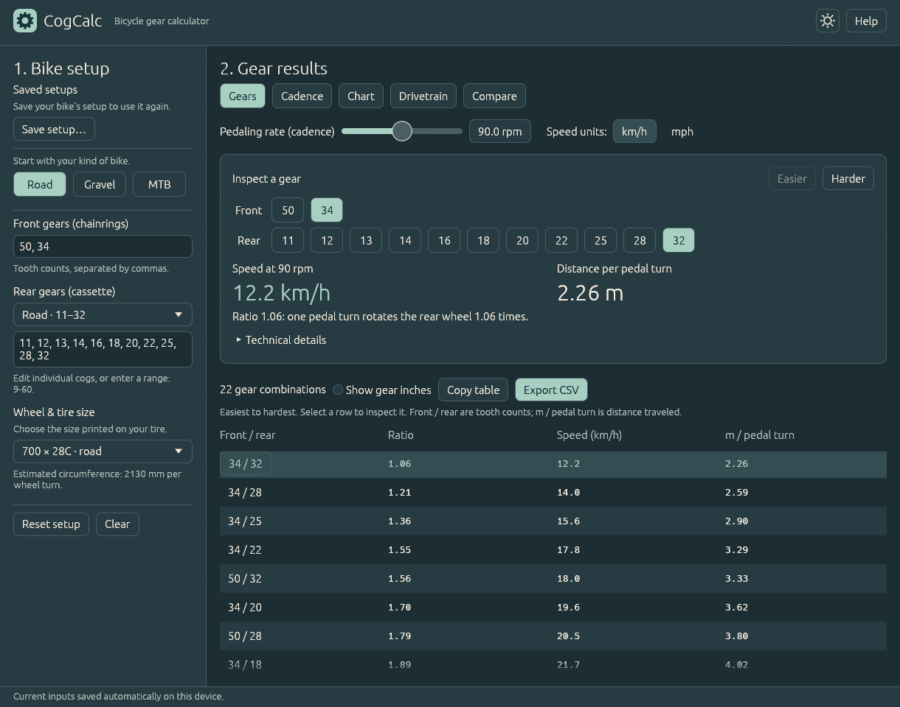
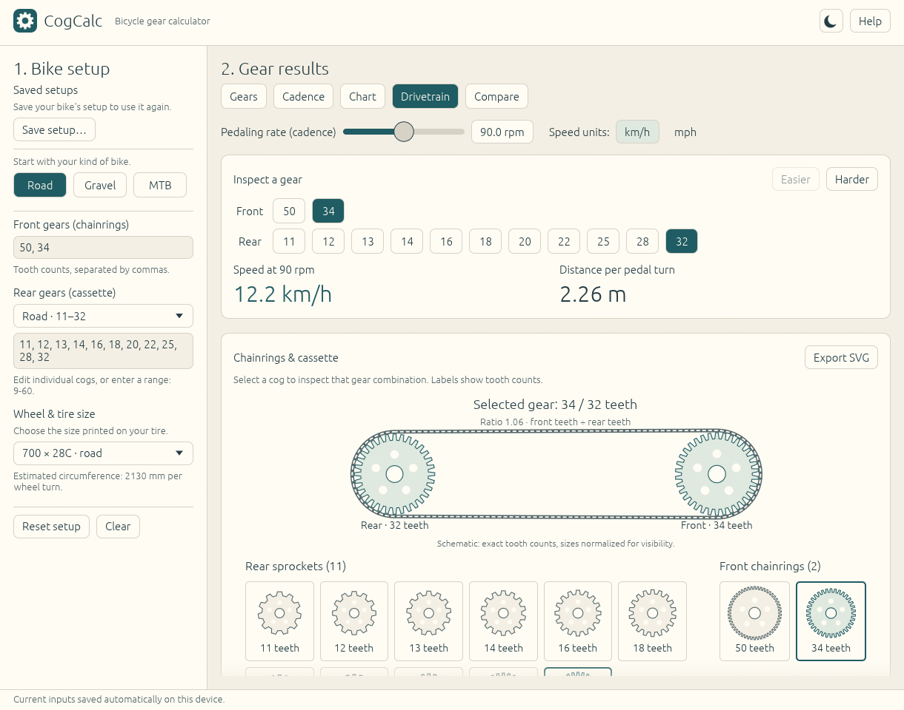

# CogCalc

A free, open-source bicycle gear calculator for Windows, macOS, and Linux.

Enter your bike's gearing and tire size to calculate speed, pedaling rate, and distance per pedal turn. The application is written entirely in Rust, with an egui/eframe desktop interface and OpenGL rendering. It runs locally without a Python runtime, browser, or webview.

## Download

**No account, installer, or Rust toolchain needed.** Choose your platform:

| Platform | Latest download | Open the app |
| --- | --- | --- |
| **Windows · 64-bit** | **[Download CogCalc.exe](https://github.com/wishdom/CogCalc/releases/latest/download/CogCalc.exe)** | Open the downloaded executable. |
| **macOS · Apple Silicon & Intel** | **[Download for macOS](https://github.com/wishdom/CogCalc/releases/latest/download/CogCalc-macos-universal.zip)** | Unzip, drag CogCalc.app to Applications, then open it. |
| **Linux · x86-64** | **[Download for Linux](https://github.com/wishdom/CogCalc/releases/latest/download/CogCalc-linux-x64.tar.gz)** | Extract the archive and run `CogCalc/CogCalc`. |

Also available: [Windows ZIP with documentation and licenses](https://github.com/wishdom/CogCalc/releases/latest/download/CogCalc-windows-x64.zip), [release notes](https://github.com/wishdom/CogCalc/releases/latest), [checksums](https://github.com/wishdom/CogCalc/releases/latest/download/SHA256SUMS.txt), and [matching source with dependencies](https://github.com/wishdom/CogCalc/releases/latest/download/CogCalc-source.tar.gz).

The Windows executable is not publisher-signed, and the macOS app is not Apple-notarized, so the first launch may require confirmation. On macOS, follow [Apple's instructions for opening an app you trust](https://support.apple.com/en-us/102445). Linux builds target Ubuntu 22.04 or newer and compatible distributions, with a graphical desktop and OpenGL; see the [Linux notes](#linux) if a system library is missing.







## What you can do

- Start with a road, gravel, or mountain-bike setup, then customize up to three chainrings and a cassette.
- Enter rear sprockets as a list (`11, 13, 15, 17`) or an inclusive range (`9-60`, as in the original calculator).
- Choose a wheel and tire preset or enter a measured circumference in millimeters.
- Set your pedaling rate from 30–150 rpm and display speed in km/h or mph.
- Pick front and rear gears with one click, or use **Easier / Harder** to step through the gearing. Table rows, chart points, and cogs in the drivetrain are also selectable.
- Switch between **Gears**, **Cadence**, **Chart**, **Drivetrain**, and **Compare**. The gear table is the default view, ordered from easiest to hardest gearing.
- Review the cadence needed at the original 5, 10, 20, 30, and 40 km/h reference speeds.
- Open **Technical details** for gear inches and overall range, or enable **Show gear inches** in the gear table.
- Save multiple named bike setups, including their gears, wheel size, cadence, and speed units; load, update, or delete them from **Saved setups**.
- Keep a comparison reference and see how different gearing or wheels change the lowest gear and highest-gear speed.
- Select a chainring or sprocket in the **Drivetrain** diagram and export the generated drawing as SVG.
- Copy all gears or export CSV from a table toolbar. Copy one selected gear from **Technical details**.
- Switch light/dark mode with the moon/sun button beside **Help**.
- Restore your current inputs, named setups, theme, gear-inches preference, and comparison reference when you reopen the app.

## Build and run

Install [Rust 1.95 or newer](https://www.rust-lang.org/tools/install), including Cargo, and the platform prerequisites below. From the repository directory:

```sh
cargo run --locked
```

For an optimized build:

```sh
cargo build --release --locked
```

Run `target/release/cogcalc.exe` on Windows, or `target/release/cogcalc` on Linux and macOS. If you have configured a shared Cargo target directory, the executable will be there instead; `cargo run --release --locked` works in either case. The first build downloads dependencies; the application itself works offline.

To build a portable Windows folder and ZIP with embedded dependency notices, first generate the matching source and notices from your committed checkout (Python 3.12 or newer is needed for this packaging step):

```powershell
python scripts/package-source.py --tag v0.2.0 --repository wishdom/CogCalc
.\scripts\package.ps1 -LegalDirectory dist/legal
```

The script creates a portable Windows folder and `dist/CogCalc-windows-x64.zip`, including documentation and license notices. Release executables also embed those notices; use **Help → Save license notices** to save a copy. Build artifacts are excluded from Git. Tagged releases build Windows, universal macOS, and Linux packages automatically through GitHub Actions.

### Windows

Use the MSVC Rust toolchain. Install Visual Studio Build Tools with **Desktop development with C++**, including the Windows SDK, if they are not already available. See the [official Rust MSVC prerequisites](https://rust-lang.github.io/rustup/installation/windows-msvc.html).

### Linux

On Ubuntu or Debian, install the native build dependencies:

```sh
sudo apt-get update
sudo apt-get install -y build-essential pkg-config libwayland-dev libxkbcommon-dev libxkbcommon-x11-0 libx11-dev libxi-dev libgl1-mesa-dev libxcb-render0-dev libxcb-shape0-dev libxcb-xfixes0-dev
```

Running the app requires a graphical Wayland or X11 session and working OpenGL drivers. For prebuilt downloads on Ubuntu/Debian, install `libxkbcommon-x11-0` if an X11 keyboard-library error prevents startup: `sudo apt-get install libxkbcommon-x11-0`. File dialogs use the XDG Desktop Portal backend: install the portal service and the backend appropriate to your desktop. The dialog library uses `libdbus`, with `zenity` as a fallback. GTK development headers are not required by this project's configuration. See the [eframe Linux notes](https://github.com/emilk/egui/tree/main/crates/eframe#readme) and [rfd backend documentation](https://docs.rs/rfd/0.17.2/rfd/#linux--bsd-backends).

### macOS

Install the Xcode Command Line Tools if needed:

```sh
xcode-select --install
```

The CI workflow defines build-time checks for Windows, Linux, and macOS. These checks do not replace interactive testing of each desktop environment.

## Using the calculator

1. Under **Bike setup**, choose a Road, Gravel, or MTB example, then match the front and rear tooth counts to your bike. Front gears are the chainrings beside the pedals; rear gears form the cassette at the rear wheel. Commas, spaces, and semicolons separate values; duplicate tooth counts are removed.
2. Choose the size printed on your tire, or select **Measured circumference** and enter the distance rolled in one full wheel turn, in millimeters.
3. Set **Pedaling rate (cadence)** and choose km/h or mph. For example, 90 rpm means 90 complete pedal turns per minute.
4. Under **Inspect a gear**, click a **Front** and **Rear** tooth-count button. Use **Easier / Harder** to move through gear ratios without opening a menu. Long rows of cogs scroll horizontally and keep the selected cog in view. The results show speed and distance per pedal turn. Selecting a table row, chart point, or cog in the drivetrain updates the same inspection.
5. Use the tabs to view all combinations, required cadence at fixed speeds, the speed chart, a drivetrain diagram, or setup comparisons.

Under **Saved setups**, choose **Save setup…** and enter a name. The picker loads that bike's gears, wheel size, cadence, and units. After editing a loaded bike, choose **Update** to replace its saved values or **Save as…** to create another entry. **Delete** asks for confirmation and removes the saved entry while keeping the current inputs.

In **Compare**, choose **Use current as reference**, then edit the bike or load a saved setup. **Replace reference** uses the current inputs as the new reference; **Clear reference** removes it. Both setups use the current cadence, and comparison percentages account for wheel size. This reference is separate from the named setup library.

**Drivetrain** draws each gear with exactly its entered number of teeth and shows the selected pair and chain as a schematic. Gear sizes are normalized for readability. Click a gear to update the inspected combination. The live view uses native vector drawing and reuses its geometry when selection changes; **Export SVG** generates the complete vector file on demand in the current theme.

**Technical details** starts collapsed and contains gear inches, overall range, and the **Copy gear** button. The gear table keeps gear inches hidden until you enable **Show gear inches**. Use **Help** for definitions and formulas. The moon button switches to dark mode; the sun switches back to light mode. Both support keyboard focus and activation.

Tooth counts must be whole numbers from 1 to 200, with at most three distinct chainrings and 64 distinct rear sprockets. Measured circumference must be between 100 and 10,000 mm. Invalid input displays an explanation and clears the results until corrected.

**Copy table** and **Export CSV** are available above the gear and cadence tables. **Ctrl+C** (**Cmd+C** on macOS) copies all gears when you are not editing a text field, including while another results tab is open. **Ctrl+S / Cmd+S** opens CSV export, and **Tab** moves between controls. **Copy gear**, inside **Technical details**, copies only the selected combination.

Clipboard output is tab-separated; CSV output is UTF-8 with column headings. Both contain all gear metrics, speed at your selected cadence, and the five reference-cadence columns, including metrics hidden in the interface. The primary speed column follows your km/h or mph selection. The export's reference columns always remain explicitly labeled **Cadence at 5/10/20/30/40 km/h (rpm)**, even when the interface displays their mph equivalents.

## Calculations and assumptions

For front teeth `F`, rear teeth `R`, wheel circumference `C` in meters, and cadence `N` in pedal revolutions per minute:

| Quantity | Formula |
| --- | --- |
| Gear ratio | `F / R` |
| Development, meters per pedal revolution | `C × F / R` |
| Speed, km/h | `development × N × 0.06` |
| Cadence, rpm | `speed_kmh / (development × 0.06)` |
| Gear inches | `(C / π / 0.0254) × F / R` |
| Total range, percent | `highest_ratio / lowest_ratio × 100` |
| Speed, mph | `speed_kmh / 1.609344` |

For example, a 50-tooth chainring, 25-tooth sprocket, and 2,100 mm circumference give a 2.00 ratio, 4.20 meters per pedal turn, and 22.68 km/h at 90 rpm. A 10–50 cassette with one chainring has a 500% range.

Wheel presets estimate circumference as `π × (bead-seat diameter + 2 × tire width)`. Actual rollout varies with tire shape, rim width, pressure, and rider load; a measured circumference is a better input. Presets use nominal tire dimensions rather than treating a wheel's marketing name as its exact outside diameter.

All chainring/sprocket combinations are shown, including combinations with equivalent ratios. The calculator does not check chainline, derailleur capacity, or component compatibility. Speed describes the relationship between gearing and cadence; it does not predict achievable speed or account for power, gradient, wind, or drag. Internal hub gearing is not modeled.

## Local settings

Your current inputs, named setup library, theme, optional gear-inches column, and comparison reference are saved locally by eframe in `app.ron`:

| Platform | Default location |
| --- | --- |
| Windows | `%APPDATA%\cogcalc\data\app.ron` |
| Linux | `~/.local/share/cogcalc/app.ron`, or `$XDG_DATA_HOME/cogcalc/app.ron` when configured |
| macOS | `~/Library/Application Support/cogcalc/app.ron` |

The current inputs are an automatically saved draft. Editing them does not overwrite a named setup until you choose **Update**. Loading a setup replaces the current draft with that entry's values.

**Reset setup** restores the road example, default cadence, and km/h units. Named setups, the comparison reference, theme, and gear-inches preference remain saved. To back up these settings and the setup library, copy `app.ron` after closing CogCalc. Removing that file resets all saved application and window state.

## Development

The warm ivory, ink, teal, and persimmon themes are an original interpretation inspired by Sanzo Wada's [A Dictionary of Color Combinations](https://en.seigensha.com/books/978-4-86152-247-5/). Text and selection colors are checked for contrast in both light and dark modes.

The calculation, validation, and table export code lives in `src/gearing.rs`; the desktop interface is in `src/app.rs`, with chart drawing in `src/chart.rs`, the SVG drivetrain view in `src/drivetrain.rs`, and styling in `src/theme.rs`. The interface uses eframe 0.36.2 with the `glow` renderer; native file dialogs use rfd 0.17.2.

```sh
cargo fmt --all -- --check
cargo clippy --locked --all-targets -- -D warnings
cargo test --locked
```

Tests cover known gearing values, the original 9–60 sprocket calculations, wheel estimates, input validation, unit conversion, inverse cadence/speed calculations, and exported tables. Headless interface tests exercise pointer input, smaller windows, invalid-edit recovery, clipboard output, and saved preferences. GitHub Actions runs Clippy and tests on Windows, Linux, and macOS, with formatting checked once on Linux.

The previous Python source and bundled executable remain available in Git history. This version builds and runs from the Rust sources alone.

## Community and contributions

Ask questions, share bike setups, and discuss ideas in [Discussions](https://github.com/wishdom/CogCalc/discussions). Use [issues](https://github.com/wishdom/CogCalc/issues/new/choose) for bug reports and concrete feature requests.

See [CONTRIBUTING.md](CONTRIBUTING.md) for development and pull request guidance. Report suspected vulnerabilities privately as described in [SECURITY.md](SECURITY.md).

## License

[GNU General Public License v3.0](LICENSE), retained from the original project.
